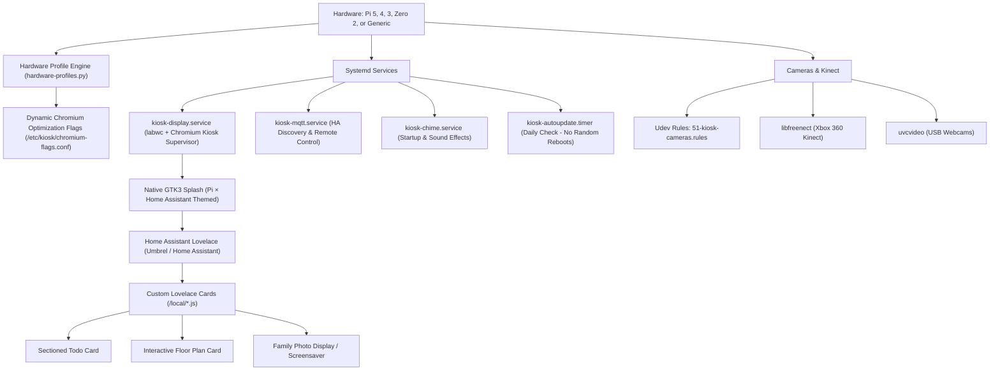

# AGENTS.md - Developer & AI Agent Guidelines for RPi Kiosk OS

Welcome! This document provides technical orientation, design principles, and operational procedures for AI coding agents and human developers maintaining or extending **RPi Kiosk OS**.

---

## 1. Project Philosophy & Scope

- **Sole Purpose**: This operating system is a **dedicated single-purpose Home Assistant Appliance**.
- **No Web Configuration GUI**: All local configuration GUIs and Web UIs have been completely eliminated to preserve 100% of memory and CPU cycles for hardware acceleration and smooth dashboard rendering. Configuration is performed exclusively via CLI (`kioskos`).
- **FullPageOS-Inspired Lean Architecture**: Boots directly into Home Assistant via hardware-accelerated Wayland (`labwc`) and Chromium in fullscreen app mode (`--kiosk --app=<dashboard_url>`) with automatic shadow DOM login injection and persistent supervisor recovery.
- **Hardware-Aware Performance Profiles**: Automatically profiles Raspberry Pi 5, 4 (8GB/4GB/2GB/1GB), 3, Zero 2 W, and generic Linux systems to tune Chromium rasterization threads, JS heap bounds, and cache locations.
- **Privacy & Security**: Generic repository files must **never** contain private IP addresses, Wi-Fi credentials, tokens, or personal identifiers. All environment-specific details are populated dynamically or read from untracked local device files.

---

## 2. System Architecture



### Core Paths
| Path | Purpose |
| :--- | :--- |
| `/opt/kiosk/` | Main runtime scripts and binaries on the Pi |
| `/etc/kiosk/config.json` | Persistent hardware & display configuration |
| `/etc/kiosk/hardware-info.json` | Detected hardware model, display resolution & active profile |
| `/etc/kiosk/chromium-flags.conf`| Generated performance flags for Chromium |
| `/usr/local/bin/kioskos` | Master administrative CLI tool |
| `/etc/systemd/system/` | Systemd service units (`kiosk-display`, `kiosk-mqtt`, `kiosk-autoupdate`) |
| `/etc/udev/rules.d/` | Udev hardware permission rules (`51-kiosk-cameras.rules`) |

---

## 3. Operational Rules for Agents

### 1. Zero Secrets in Git
- Do not commit IP addresses, user credentials, or tokens.
- Reference configuration templates such as `agent-device.env.example`.
- Device-specific credentials stay on-device in `/opt/kiosk/agent-device.env` and in `/etc/kiosk/config.json`.

### 2. Fast CLI-First Appliance Management
- Manage all aspects using `kioskos`:
  - Query status: `kioskos status`
  - Inspect hardware: `kioskos hw`
  - Apply hardware profiles: `kioskos profile apply <profile_id>`
  - Change URL: `kioskos url <url>`
  - Auto-login: `kioskos autologin <user> <pass>`
  - Backup: `kioskos backup create --sanitized` / `kioskos backup restore <file>`
  - Update: `kioskos update`

### 3. Display & Screen Sleep Controls
- **Screen Sleep**: Triggered via `kioskos screen sleep` or Home Assistant REST/MQTT command (`/opt/kiosk/screen-control.sh sleep`).
- Turns off HDMI video signal via Wayland DPMS (`wlopm --off`).
- Launches `kiosk-wake-watcher.py` in the background to listen exclusively for keyboard key presses to wake the monitor.
- **Screen Wake**: Press any key on the keyboard, or call `kioskos screen on` / `/opt/kiosk/screen-control.sh on`.

### 4. Background Updates (Never Spontaneous Reboots)
- `kiosk-autoupdate.timer` runs daily in the background.
- It compares GitHub remote commit hashes with `/opt/kiosk/.git_commit`.
- When an update is detected, it syncs files and restarts `kiosk-display.service`.
- It **never** issues a spontaneous system reboot. System reboots are only triggered when explicitly requested by an administrator or agent (`kioskos reboot`).

### 5. Live Browser Inspection & CDP Control
- Chromium runs with remote debugging enabled on port `9222`.
- You can query open tabs and reload the page using Chrome DevTools Protocol:
  ```bash
  curl -s http://127.0.0.1:9222/json
  ```
- To capture live screenshots of the kiosk display over Wayland:
  ```bash
  WAYLAND_DISPLAY=wayland-0 grim /tmp/kiosk-shot.png
  ```

---

## 4. Hardware & Camera Specifications

### Supported Hardware
1. **Raspberry Pi 5 / 4 / 3 / Zero 2 W**:
   - Automated profiling applies appropriate GPU acceleration flags, JS heap limits, and raster threads.
2. **Xbox 360 Kinect** (`045e:02ad`, `045e:02ae`, `045e:02b0`):
   - Handled via `libfreenect` native drivers and udev permissions in `plugdev` group.
3. **Xbox One / V2 Kinect** (`045e:02c4`, `045e:02d8`):
   - Udev rules configured for `libfreenect2`.
4. **Generic USB Webcams**:
   - Standard Linux Kernel `uvcvideo` driver mapping to `/dev/video0`.

---

## 5. Working with Multiple Agents

When switching between development environments or AI agents (Antigravity, Claude, ChatGPT, Cursor):
1. **Local Git Workspace**: Use the local repository `/Users/8air/rpi-kiosk-os` for code changes, documentation, and commits.
2. **Device Deployment**: Use SSH/SCP to push verified code to the target Pi at `/opt/kiosk/`.
3. **Device Configuration File**: Inspect `/opt/kiosk/agent-device.env` on the physical device to discover the live IP, active peripherals, and service states.
